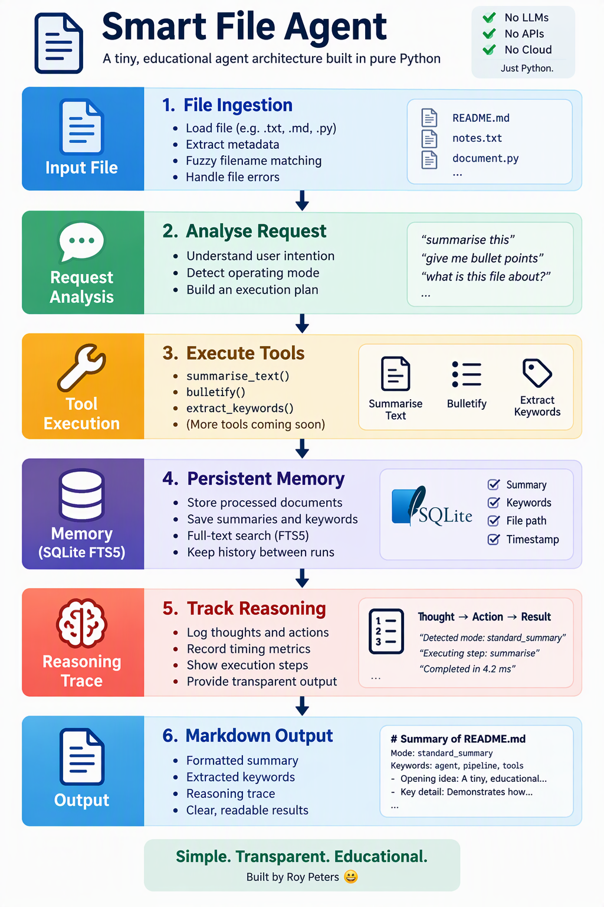

# 🗄️ Smart File Agent


A tiny, educational demonstration of an agentic AI pipeline built entirely in Python.
No LLMs. No APIs. No cloud services.
Just a simple, transparent implementation of how agent-style systems work under the hood.

---

## 📑 Table of Contents

- [Why Was This Built](#-why-was-this-built)
- [Design Philosophy](#-design-philosophy)
- [Agent Pipeline](#-agent-pipeline)
- [Screenshots](#-screenshots)
- [Project Structure](#-project-structure)
- [Installation](#-installation)
- [Running the Agent](#️-running-the-agent)
- [Supported Prompts](#-supported-prompts)
- [How It Works](#-how-it-works)
- [Example Output](#-example-output)
- [Testing](#-testing)
- [Roadmap Features](#️-roadmap-features)


---

## 🧠 Why Was This Built

Smart File Agent is a miniature implementation of an agentic AI workflow.

The project demonstrates how modern AI systems are commonly structured:

- Input ingestion
- Request analysis
- Planning
- Tool execution
- Output generation

Unlike production AI systems, Smart File Agent intentionally avoids external AI APIs and large frameworks. The focus is on understanding the architecture rather than hiding the logic behind a model.

---

## 🎯 Design Philosophy

Many AI tutorials jump directly to calling a model API.

This project takes the opposite approach.

The goal is to demonstrate:

- How an agent receives information
- How requests are analysed
- How plans are created
- How tools are selected
- How outputs are generated

Everything is intentionally small, readable, and educational.

The system uses simple rule-based reasoning rather than a large language model.

---

## 🔄 Agent Pipeline

The Smart File Agent follows a straightforward processing workflow:

```text
File
  │
  ▼
Ingestion
  │
  ▼
Request Analysis
  │
  ▼
Planning
  │
  ▼
Tool Execution
  │
  ▼
Structured Output
```

Current processing modes:

- Standard summary
- Bullet-point summary

---

## 📸 Screenshots

The diagram below illustrates the architecture used by the project.



---

## 📁 Project Structure

```text
smart_file_agent/
├── smart_file_agent/
│   ├── __init__.py
│   ├── main.py
│   └── agent/
│       ├── __init__.py
│       ├── agent_core.py
│       ├── ingestion.py
│       ├── logging_config.py
│       ├── output.py
│       ├── processing.py
│       └── tools.py
│
├── tests/
│   ├── test_agent_core.py
│   ├── test_ingestion.py
│   ├── test_logging_config.py
│   ├── test_main.py
│   ├── test_output.py
│   ├── test_processing.py
│   ├── test_tools.py
│   └── test_tools_hypothesis.py
│
├── CONTRIBUTING.md
├── LICENSE.md
├── pyproject.toml
└── README.md
```

---

## 📦 Installation

This project uses **uv** for dependency management.

Install dependencies:

```bash
uv sync
```

---

## ▶️ Running the Agent

From the project root:

```bash
uv run python -m smart_file_agent.main
```

You will be prompted for:

```text
Enter file path:
```

and

```text
What would you like to do?
```

Example:

```text
Enter file path: notes.txt
What would you like to do? bulletify
```

---

## 💬 Supported Prompts

The agent currently supports natural-language requests such as:

### Summaries

```text
summarise this
```

```text
give me a summary
```

```text
summarise the file
```

```text
what is this file about
```

### Bullet Summaries

```text
bulletify
```

```text
give me bullet points
```

```text
turn this into bullets
```

```text
bullet summary please
```

The request analyser determines which execution mode should be used.

---

## ⚙️ How It Works

### 📥 Ingestion Layer

**ingestion.py**

Responsibilities:

- Load files
- Extract metadata
- Provide fuzzy filename matching
- Handle file-related errors

---

### 🧠 Processing Layer

**processing.py**

Responsibilities:

- Analyse user intention
- Determine operating mode
- Build execution plans

---

### 🛠️ Tool Layer

**tools.py**

Current tools:

- `summarise_text()`
- `bulletify()`

These tools perform the actual transformations on the input content.

---

### 🤖 Agent Core

**agent_core.py**

Responsibilities:

- Execute the processing pipeline
- Track reasoning steps
- Execute tools
- Record timing information
- Build trace output

---

### 📝 Output Layer

**output.py**

Responsibilities:

- Format agent results
- Generate markdown output
- Present reasoning traces

---

## 🧾 Example Output

```text
============================================================

AGENT OUTPUT

============================================================

Summary of project_notes.txt

Mode: bullet_summary

Steps: extract_text, summarise, bulletify

- Opening idea: ...
- Key detail: ...
- Keywords: ...

============================================================
```

---

## 🧪 Testing

Run the full test suite:

```bash
uv run pytest
```

Run test coverage:

```bash
uv run pytest --cov
```

The project includes:

- pytest
- pytest-cov
- hypothesis

Example coverage run:

```bash
uv run pytest --cov=smart_file_agent
```

---

## 🛣️ Roadmap Features

- [x] Agent orchestration pipeline
- [x] Reasoning traces
- [x] Timing metrics
- [x] Fuzzy file matching
- [x] Structured markdown output
- [x] Property-based testing with Hypothesis
- [x] Memory system
- [ ] Tool registry
- [ ] FastAPI interface
- [ ] Additional text-processing tools
- [ ] Export formats beyond Markdown

---

Built by **Roy Peters** 😁

